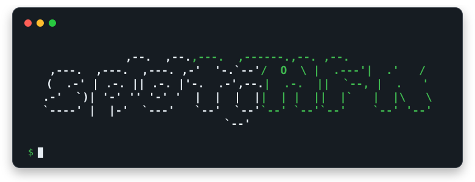
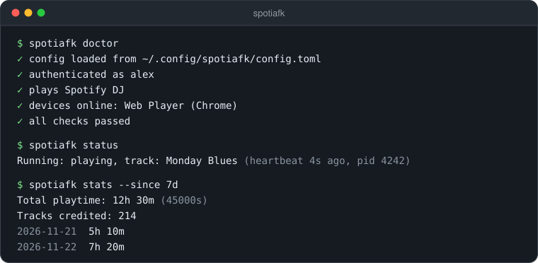

<div align="center">
  
  <p>Plays Spotify on a spare device while you're away, and hands it back the moment you're not.</p>
  <p><sub>Based on <a href="https://github.com/Staninna/SpotiAFK">SpotiAFK</a> by <a href="https://github.com/Staninna">Staninna</a>, changed in November 2026 (<a href="#upgrading">what changed</a>).</sub></p>
  <p>
    <a href="https://github.com/bloker0000/SpotiAFK/releases/latest"></a>
    <a href="https://github.com/bloker0000/SpotiAFK/commits/master"></a>
    <a href="https://github.com/bloker0000/SpotiAFK/actions/workflows/ci.yml"></a>
    <a href="LICENSE"></a>
  </p>
  <p>
    
    
    
    
    
  </p>
  <p>
    <a href="#how-it-works">How it works</a> |
    <a href="#quick-start">Quick start</a> |
    <a href="#windows">Windows</a> |
    <a href="#configuration">Configuration</a>
  </p>
  
</div>

## What it does

SpotiAFK watches your Spotify account. When nothing has played for 15 minutes, it starts music on a device you picked: a Raspberry Pi, a spare phone, or on Windows a hidden web player. It plays one of your playlists, a playlist you follow, or Spotify's DJ. The moment you pause it, pick something else or move it to your own device, it stops and puts your own music back where you left it.

## Before you use it

- Spotify's terms forbid bots and scripts that pump up play counts. Plays from a tool like this can be filtered out, your account can get suspended, and the artist you meant to support can get their release flagged.
- It needs Spotify Premium, remote playback only works there.
- It plays on your account, so its plays end up in your history, recommendations and Wrapped. A second account, like a member of a family plan, keeps them apart.

## How it works

Every 30 seconds it checks what your account is playing. After 15 minutes of nothing (`idle_minutes`), it plays on a `play_on` device. While it plays, it checks every second whether you took over:

| You do this while it plays       | It does this                                                    |
| -------------------------------- | --------------------------------------------------------------- |
| Pause it                         | Puts your last track back on your device, paused at your spot   |
| Pick something else to play      | Moves your pick to your device                                  |
| Move playback to your own device | Swaps its track there for your last one, at your spot           |

Your device is its best guess, in this order: a device that came online while it played (opening Spotify makes it show up), the one you last played on, this computer's own Spotify app, or the only other device online. When none of those settle it, playback stays where it is. Set `hand_back = false` when `play_on` is a device you also listen on yourself.

## Quick start

You need Python 3.11 or newer and Spotify Premium.

```bash
git clone https://github.com/bloker0000/SpotiAFK && cd SpotiAFK
python3 -m venv venv && source venv/bin/activate   # on windows: venv\Scripts\activate
pip install -e .

spotiafk setup     # spotify app details, login, what to play and where (about 3 minutes)
spotiafk run       # ctrl-c stops it
```

`setup` can't make the Spotify app for you. Go to the [developer dashboard](https://developer.spotify.com/dashboard), create an app, tick Web API, and add `http://127.0.0.1:8888/callback/` as a Redirect URI. `setup` asks for its Client ID and secret and does the rest.

Spotify lets apps like this read only the playlists you made yourself. `setup` saves the DJ and playlists you follow as links, and those play as a whole, like starting them in the app.

## Windows

Players like librespot and spotifyd don't get audio on new accounts anymore, so on Windows SpotiAFK uses Spotify's own web player: a muted Chrome window with its own profile, tucked away off screen, see-through and without a taskbar button. Chrome has to be installed.

1. `windows\start.ps1` starts a small watcher in the background, which starts the web player and SpotiAFK and keeps them running.
2. The first time, `windows\player-window.ps1 -Show` brings the window back. Log in to Spotify there, then run `windows\player-window.ps1` to tuck it away again.
3. Set `play_on = ["Web Player (Chrome)"]` in your config.
4. `windows\autostart.ps1` starts it all when you log in to Windows.

The watcher restarts whatever stops and only shows a notification when it needs you: when Spotify wants you to log in again, when the web player is offline for 10 minutes, when Spotify can't be reached for 10 minutes, or when SpotiAFK keeps stopping.

| Script                      | What it does                                                      |
| --------------------------- | ----------------------------------------------------------------- |
| `windows\start.ps1`         | Starts the watcher, which starts and keeps up everything else    |
| `windows\stop.ps1`          | Stops the watcher, SpotiAFK and the web player                    |
| `windows\player-window.ps1` | Tucks the web player away, `-Show` brings it back                 |
| `windows\autostart.ps1`     | Runs `start.ps1` when you log in, `-Remove` undoes it             |

If you use open.spotify.com in Chrome yourself, it shows up under the same device name, so keep that one closed while SpotiAFK runs.

## Configuration

`spotiafk setup` writes `~/.config/spotiafk/config.toml`. A `./spotiafk.toml`, a `--config PATH` flag or `$SPOTIAFK_CONFIG` overrides that. Your login, play history, status and logs live in `~/.local/share/spotiafk/`. Every option is in [`spotiafk.toml.example`](spotiafk.toml.example).

| Option                   | Default  | What it does                                                         |
| ------------------------ | -------- | -------------------------------------------------------------------- |
| `playlist`               |          | One of your playlists by name, or a Spotify link to play as a whole  |
| `play_on`                |          | Device names to play on, as Spotify shows them                       |
| `spotify.client_id`      |          | From your app on the developer dashboard                             |
| `spotify.client_secret`  |          | Same                                                                 |
| `playback.skip_after`    | `0`      | `0` plays tracks in full, or seconds per track (at least 31)         |
| `playback.shuffle`       | `true`   | Shuffles your own playlist each round, links play in Spotify's order |
| `playback.hand_back`     | `true`   | Puts your music back on your device when you take over               |
| `checks.idle_minutes`    | `15`     | How long nothing plays before it starts                              |
| `checks.interval`        | `30`     | Seconds between checks while it waits                                |
| `checks.retry`           | `10`     | Seconds before retrying after an error, doubles up to 5 minutes      |

## Commands

| Command             | What it does                                                          |
| ------------------- | --------------------------------------------------------------------- |
| `spotiafk setup`    | Guided first setup, writes the config                                 |
| `spotiafk run`      | Runs it in the foreground, ctrl-c stops it                            |
| `spotiafk status`   | Is it running and what is it doing (`--json` for scripts)             |
| `spotiafk stats`    | Total playtime and a per-day breakdown (`--since 7d`, `--json`)       |
| `spotiafk doctor`   | Checks config, login, Premium, playlist and devices, with a fix each  |

Exit codes: 0 ok, 1 runtime error, 2 usage, 3 invalid config, 4 login failed, 5 not running (`status`).

From Python:

```python
from spotiafk import Client, Config

client = Client(Config.load())  # or Client() for the default locations
client.run()  # blocks until ctrl-c
client.read_status()  # dict from the run loop's heartbeat
client.read_stats()  # Stats(total_seconds, tracks, by_day)
```

## Upgrading

From 2.x:

- Telegram notifications are gone, a `[telegram]` section is ignored.
- Tracks play in full by default now. `skip_after = 35` brings back the old cut.
- `idle_minutes` replaces `idle_checks`. An old `idle_checks` still works.
- Your play history moves to clearer keys by itself on the first start.
- In Python, `status()` and `stats()` are now `read_status()` and `read_stats()`.

From 1.x: an `options.py` next to the code still works as config, your `token-*.dat` and `time.txt` come along on the first start, and `python3 spotiAFK.py` still starts it.

## Development

```bash
pip install -e . ruff pytest
ruff format .    # 120 characters per line
ruff check .
pytest
```

CI runs the same on Windows and Linux with Python 3.11 and 3.13, and checks the PowerShell scripts parse.

## License

GPL-3.0 like the original, see [LICENSE](LICENSE).
